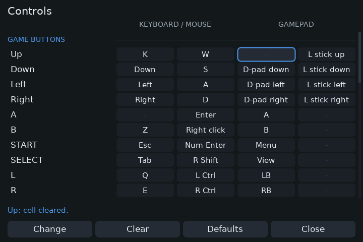
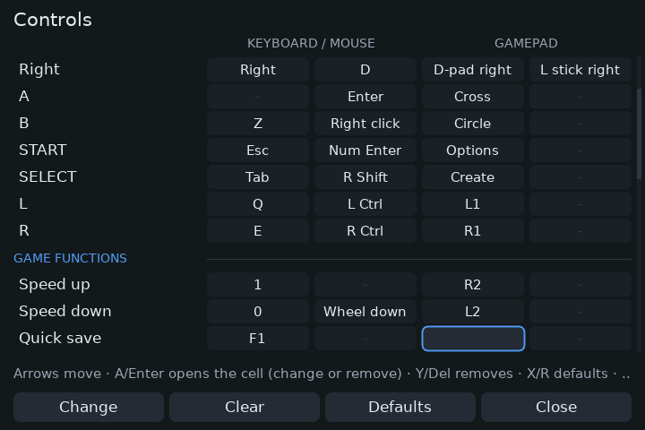

# Trainer Controls

Control mapping for Pokémon FireRed/LeafGreen on Gen1Recomp (mod API 3): every button of the game, its functions and a set of field shortcuts, on keyboard, mouse and gamepad.





## What it does

- **Remaps everything.** Each action has two cells for keyboard and mouse and two for the gamepad. The game's own key table is bypassed: a control you remove is really gone.
- **Actions:**
  - *Game buttons:* Up, Down, Left, Right, A, B, START, SELECT, L, R.
  - *Game functions:* speed up/down, quick save/load, zoom in/out, zoom and tilt cycling.
  - *Field shortcuts:* Cut, Surf, Fly, Strength, Flash, Rock Smash, Waterfall, Dig, Teleport, Sweet Scent, Bicycle, Itemfinder, VS Seeker.
  - *Mods:* the controls screen itself, and anything another mod registers.
- **Field shortcuts have their own context.** They act while you walk on the map; the same input may be bound to something else for menus and battles (R1 = Cut on the map, R in the Bag). Each shortcut goes down the game's own path, so it works only when the menu would offer it.
- **Inputs:** any keyboard key, mouse buttons and wheel, gamepad buttons, triggers, both sticks, and buttons LÖVE has no name for (the DualSense touchpad click shows as "Extra N").
- **Button names** for PlayStation, Xbox and Nintendo pads, chosen from the connected gamepad or with the **Gamepad button names** option.
- **Controls screen** over the game (F8 by default; F8 always opens it when nothing is bound to it), and a **Controls** panel in Trainer Desk.

## Using the screen

| | Keyboard | Gamepad | Mouse |
| --- | --- | --- | --- |
| Move | arrows | D-pad / left stick | wheel scrolls |
| Open the cell (Change / Remove / Cancel) | Enter, Z, Space | A (bottom button) | click the cell (goes straight to Change) |
| Clear the cell | Del | Y (top button) | Clear |
| Defaults (asks twice) | R | X (left button) | Defaults |
| Close | Esc, Backspace, X, F8 | B, START | Close |

After choosing a cell, press the key or button you want. Every key and button is an answer there, so the wait ends by itself after 6 seconds or with **Cancel**. Nothing is taken from other actions: if the input already does something else that can happen in the same place, both cells turn red and the note under the list says which (see Conflicts).

## Conflicts

Each action has the places where it can happen: field shortcuts on the map only, L and R in menus and battles only, everything else everywhere. Two actions on one input are a conflict only when they share a place. Cut, Rock Smash, Surf, Waterfall and Strength act on what is in front of you and never apply together, so they may share one input (the one that fits is used). Conflicts are allowed but marked in red and counted in the title; only one of the two answers.

## Compatibility

| | |
| --- | --- |
| Games | FireRed and LeafGreen |
| Gen1Recomp | 0.3.93 or newer (mod API 3); tested on 0.4.8 |
| Conflicts | `pad_shortcuts` (this mod replaces it) |

The game's own CONTROLS menu still opens, but its choices no longer matter while this mod is on.

## Installation

Copy the `trainer_controls` folder into `%APPDATA%\pokemon-love2d\mods`. Trainer Desk is optional (for the panel).

## Options

| Option | Default | What it does |
| --- | --- | --- |
| Language | English | ENGLISH, ESPANOL, PORTUGUES or JAPANESE. |
| Gamepad button names | Auto | AUTO, XBOX, PLAYSTATION or NINTENDO. |
| Ask before Teleport | On | The Teleport shortcut asks first. |

## For other mods

```lua
local controls = mod.find("trainer_controls")
local api = controls and controls.exports and controls.exports.controls
if api and api.api == 1 then
  api.register({ id = "my_mod.do_it", label = "Do it", run = function(game) ... end })
end
```

`context = "field"` makes it a field shortcut. The player binds it on the controls screen; the binding is remembered by id.

## Documentation

- [docs/GUIDE.md](docs/GUIDE.md): player guide.
- [docs/ARCHITECTURE.md](docs/ARCHITECTURE.md): how inputs reach actions.
- [docs/TRANSLATING.md](docs/TRANSLATING.md), [docs/PUBLISHING.md](docs/PUBLISHING.md), [CHANGELOG.md](CHANGELOG.md).

## Known limits

- One layout for every gamepad; two gamepads act as one.
- No combinations (two buttons for one action).
- Touch controls are not changed.

## What it changes in the game

[DIFFERENCES.md](DIFFERENCES.md) lists everything this mod does differently from the unmodded game.

## License

MIT. The bundled font is under the SIL Open Font License (`trainer_controls/fonts/OFL.txt`).
